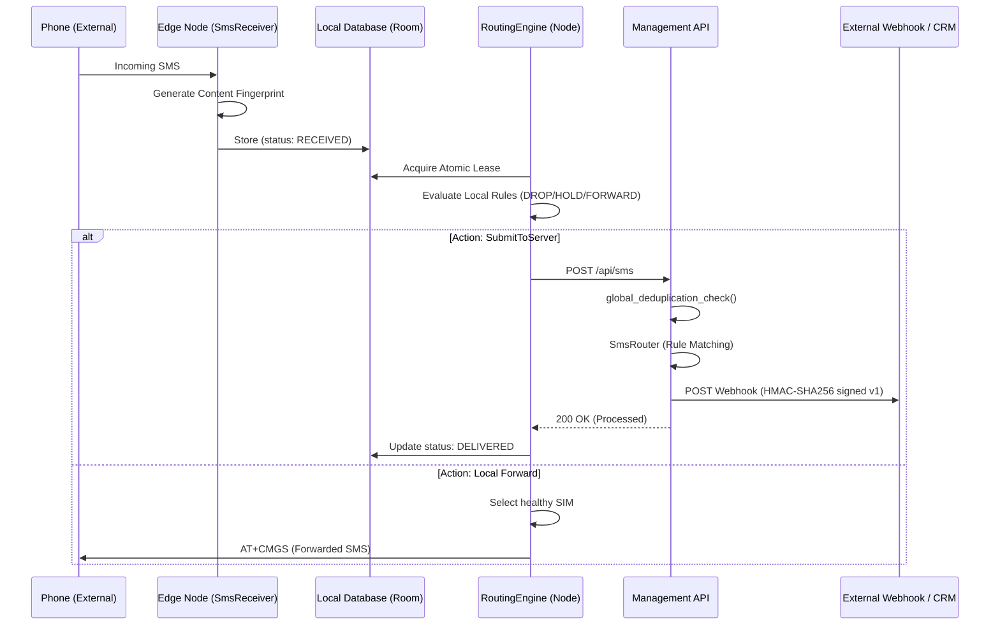
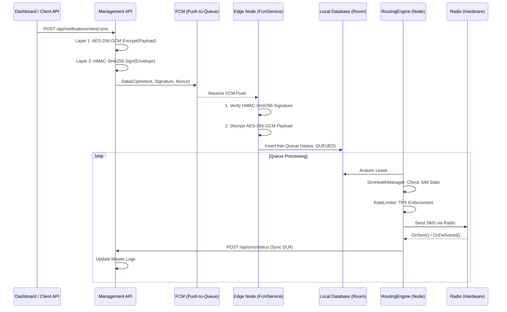
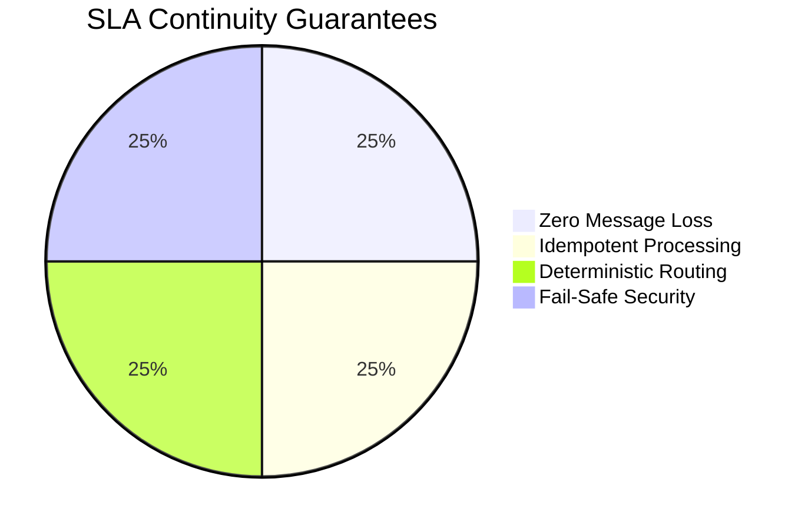
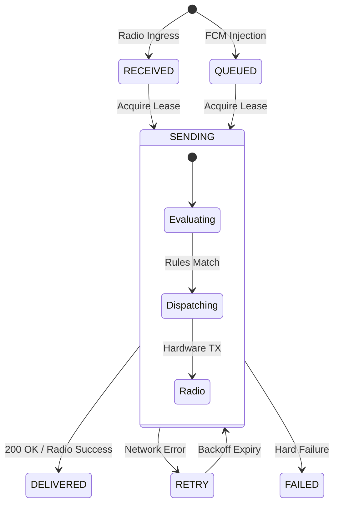
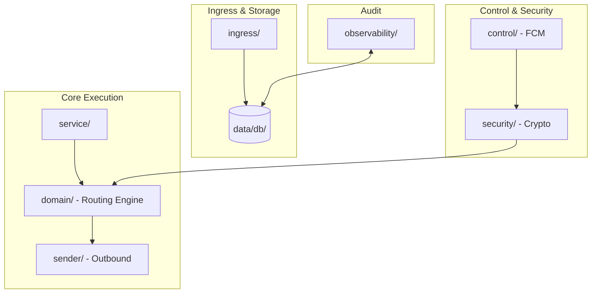
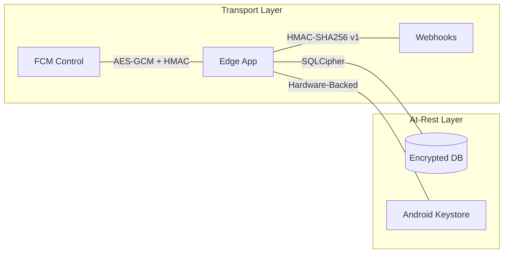
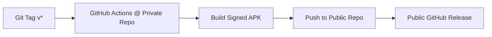
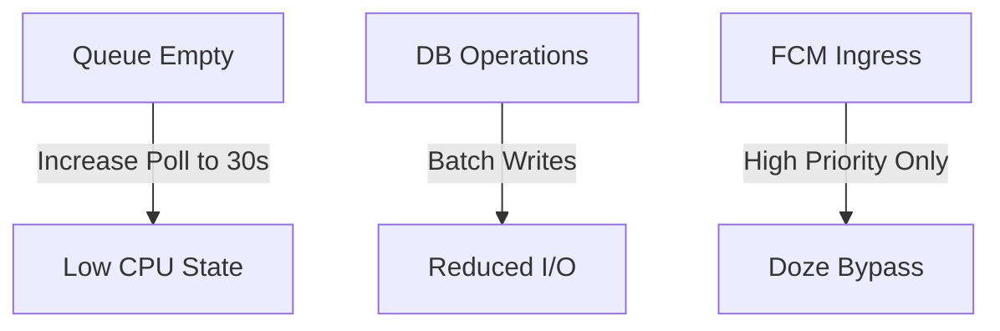

# SMS Routing Enterprise Gateway 🚀

An enterprise-grade, edge-computing SMS gateway system designed for high reliability, compliance, and multi-node scalability. This system consists of a **Lumen-based Management API** and **Android Edge Nodes**.

---

## 🏗️ System Architecture

The gateway operates using a dual-layered routing architecture. Local decisions (TPS, SIM health) are made at the Edge, while global decisions (Webhooks, Transformation, Multi-device coordination) are handled by the Server.

### 1. Ingress Flow (Receiving SMS)
**Flow Highlights:** Mobile Network → Edge Node → Server → External Integrations



### 2. Egress Flow (Sending SMS)
**Flow Highlights:** Dashboard/API → Management Server → Edge Node → Mobile Network



---

## 📱 SMS Edge Node (Android Agent)

SMS Edge Node is a **carrier‑grade Android SMS routing agent** designed for extreme reliability (target SLA: 99.99999% under defined conditions).

### Core Guarantees


### Agent State Machine


### Module Breakdown


---

## 🔒 Security Model



### Abuse & Compliance
- **Premium Blocking**: Automatic rejection of 900x prefix outbound attempts.
- **Rate Limiting**: Enforced per-SIM TPS and daily/monthly quotas.
- **IMEI Binding**: Optional enforcement binding SIM cards to specific hardware IDs.

---

## 🚀 Deployment & Release

### Release Workflow (Private Source → Public Repo)


### Setup Requirements
1.  **Public Repo**: Create an empty public repository (e.g., `my-org/sms-gateway-public`).
2.  **Secret Token**:
    - Generate a Personal Access Token (PAT) with `repo` scope.
    - Add it to this private repo's secrets as `PUBLIC_REPO_TOKEN`.
3.  **Workflow Config**: Update `.github/workflows/android-release.yml` with the public repo name.

### 🔐 Required Secrets
Add these in your **Private Repo** under `Settings` → `Secrets and variables` → `Actions`.

| Secret Name | Description | How to Get It |
| :--- | :--- | :--- |
| `KEYSTORE_PASSWORD` | Password for your release keystore file (`.jks`). | You defined this when running `keytool` to generate the keystore. |
| `KEY_PASSWORD` | Password for the key alias inside the keystore. | Usually same as above, defined during `keytool` generation. |
| `PUBLIC_REPO_TOKEN` | GitHub Personal Access Token (PAT) to publish to the public repo. | GitHub → Settings → Developer settings → PATs (Classic) → New Token → Select `repo` scope. |
| `KEYSTORE_BASE64` | The actual keystore file, encoded in Base64. | Run `base64 -w 0 keystore.jks` in your terminal and copy the entire output. |

### Prerequisites
- Android Studio Hedgehog+ | API 26+ (Android 8.0+)
- Firebase project with FCM and Crashlytics.
- Correct `google-services.json` in `app/`.

---

## 🔋 Battery & Performance

**Target Drain: <5% per 24h**



---

## 🧪 Testing & Verification

### Diagnostic SQL
```bash
# View recent queue activity
adb shell "run-as com.sms.edgenode sqlite3 /data/data/com.sms.edgenode/databases/edge_node_db 'SELECT id, status, attempts FROM sms_queue ORDER BY receivedAt DESC LIMIT 10;'"

# View security audit trail
adb shell "run-as com.sms.edgenode sqlite3 /data/data/com.sms.edgenode/databases/edge_node_db 'SELECT eventType, details FROM audit_log ORDER BY timestamp DESC LIMIT 5;'"
```

---

## ✅ Production Checklist
- [ ] **Firebase**: FCM enabled, `google-services.json` present.
- [ ] **Keystore**: Production keys generated and environment variables set.
- [ ] **Permissions**: SMS, Phone State, and Notifications granted on device.
- [ ] **Exclusions**: Battery optimization set to **Unrestricted** for the app.
- [ ] **Signatures**: Rotate rule-signing keys every 90 days.

---

## ⚠️ Warning
This is **infrastructure software** running on consumer hardware. Treat Android as a hostile runtime. Failure to disable battery optimizations or grant required permissions will result in delivery failure.
